<h1 align="center">Radiant</h1>

<p align="center">
  <b>A fast, local-first mind-map editor for macOS, with branches you can almost touch.</b>
</p>

<p align="center">
  
  
  
  
  
</p>

<p align="center">
  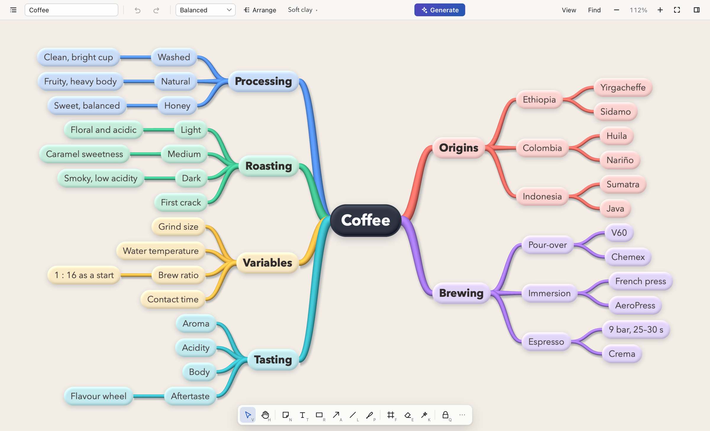
</p>

Radiant is a desktop mind-mapping app. Every branch is drawn by its own WebGL renderer, so maps can look like rope, rolled paper or soft clay and still pan smoothly at 50,000 nodes. Your maps are ordinary files on your own disk. AI drafting is there when you want it and absent when you don't.

## Branches made of real materials

Four themes give branches depth, light and shadow. They are built from geometry, so they stay sharp at any zoom.

<table>
  <tr>
    <td width="50%">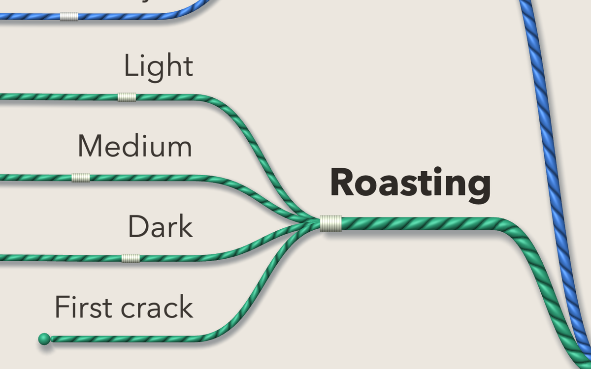<br><p align="center"><b>Rope</b></p></td>
    <td width="50%">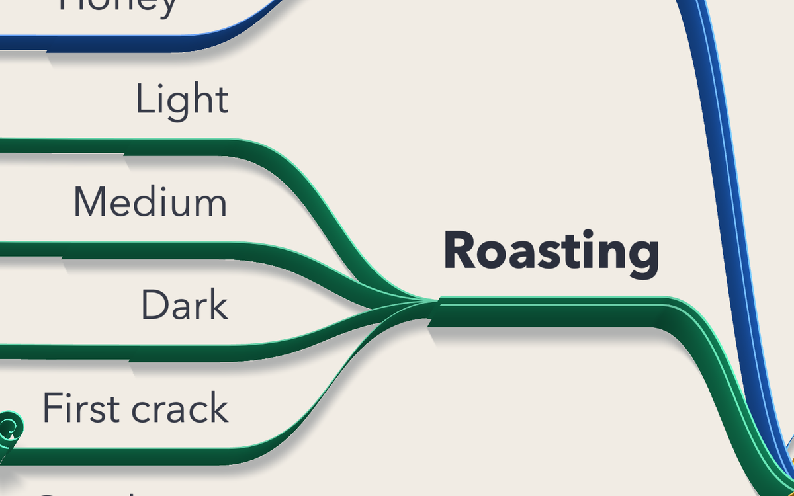<br><p align="center"><b>Paper quilling</b></p></td>
  </tr>
  <tr>
    <td width="50%">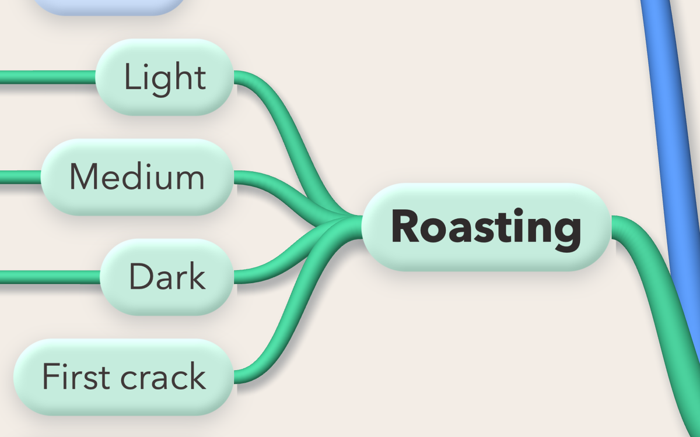<br><p align="center"><b>Soft clay</b></p></td>
    <td width="50%">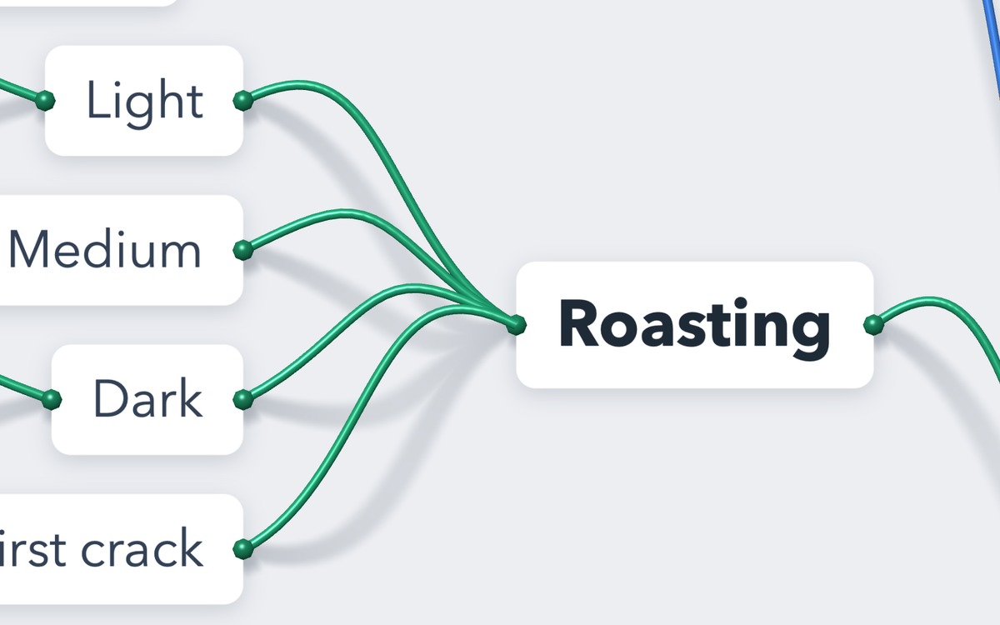<br><p align="center"><b>Lifted arcs</b></p></td>
  </tr>
</table>

## One map, fourteen looks

Switch the theme and the whole map restyles: colours, branch shapes, node shapes and typography. Each theme has a light and a dark appearance.

<table>
  <tr>
    <td width="50%">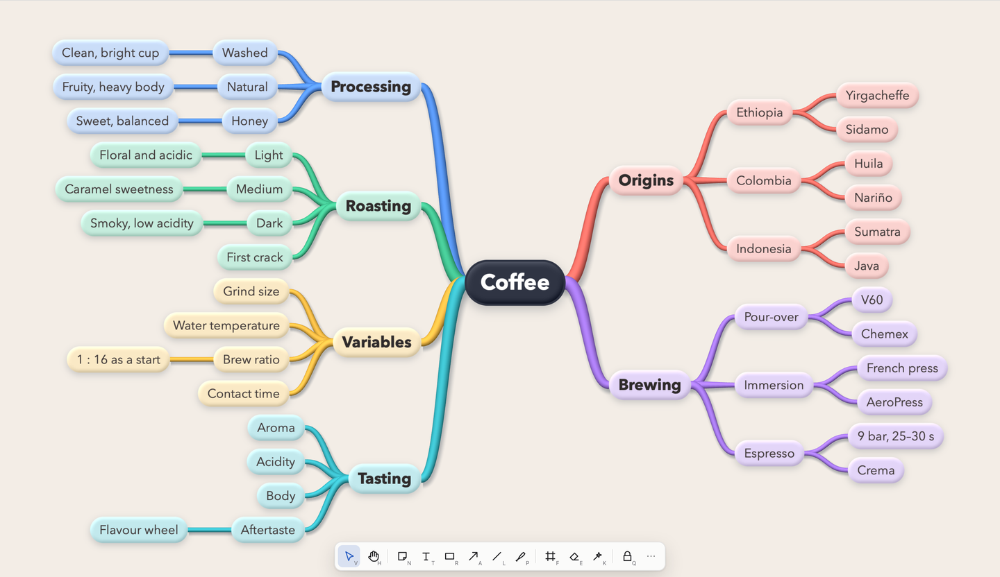<br><p align="center">Soft clay</p></td>
    <td width="50%">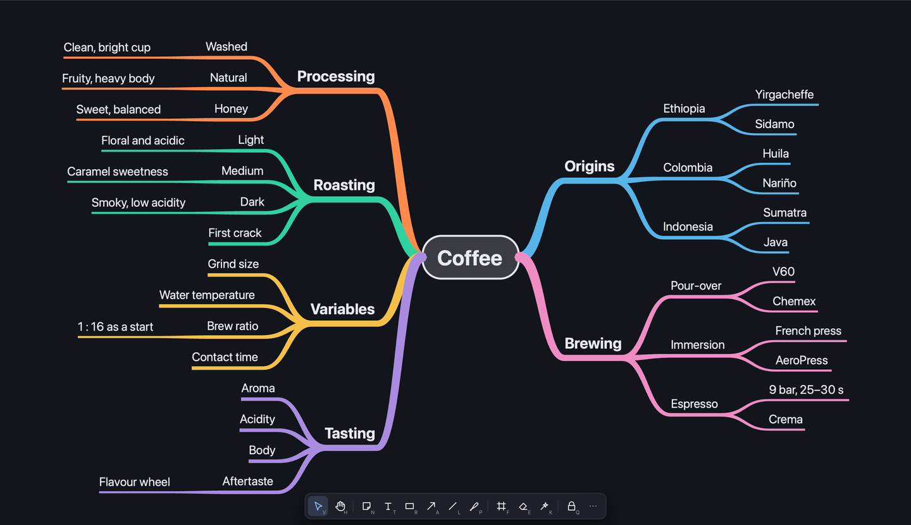<br><p align="center">Midnight</p></td>
  </tr>
  <tr>
    <td width="50%">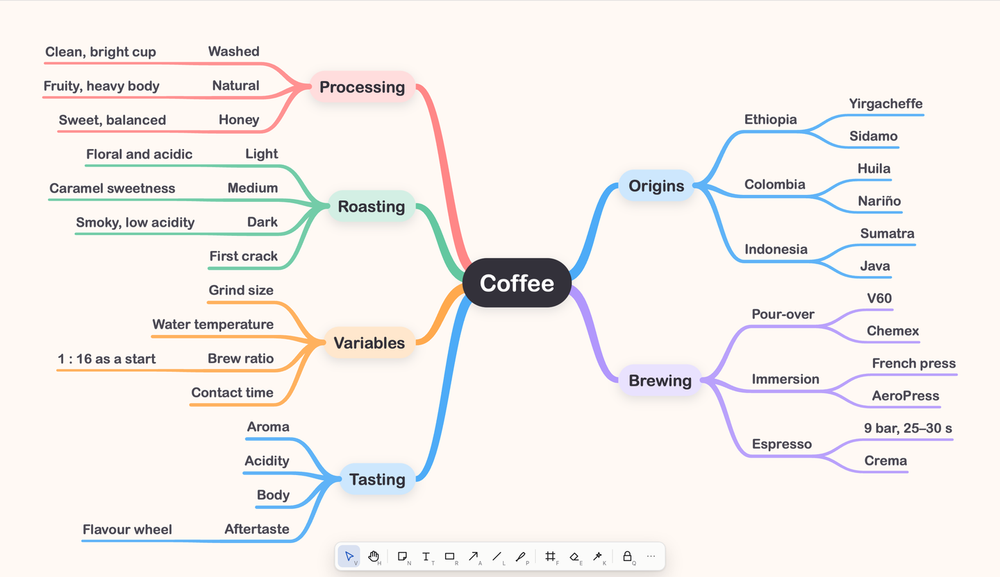<br><p align="center">Sorbet</p></td>
    <td width="50%">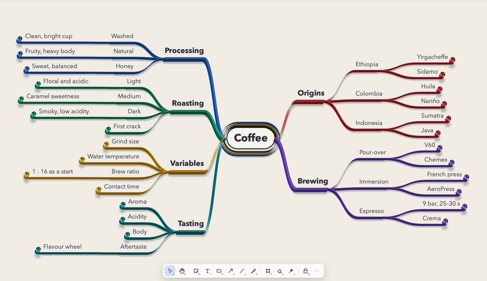<br><p align="center">Paper quilling</p></td>
  </tr>
  <tr>
    <td width="50%">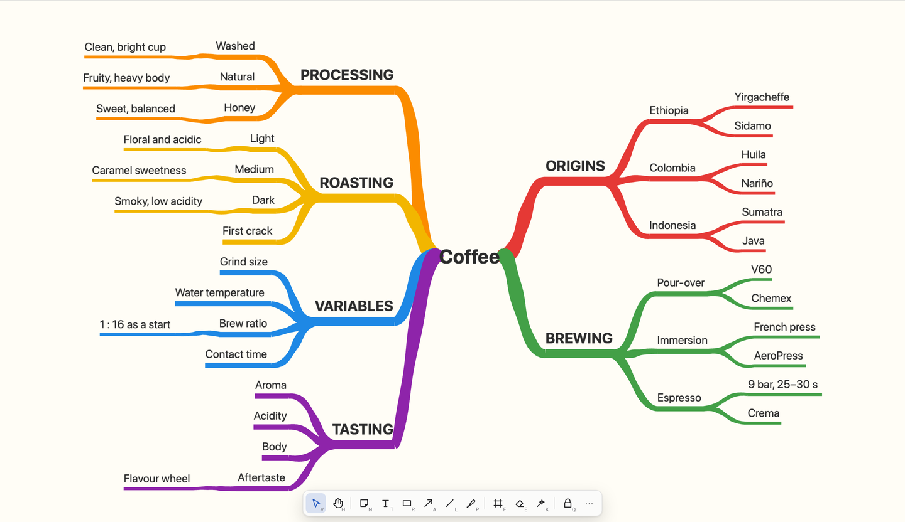<br><p align="center">Buzan strict</p></td>
    <td width="50%">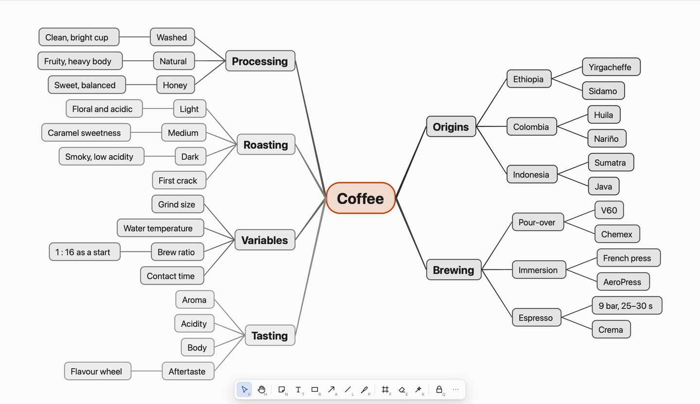<br><p align="center">Ink</p></td>
  </tr>
</table>

## Sketch on the same canvas

The map sits on an open canvas with a full set of whiteboard tools: sticky notes, hand-lettered text, rectangles, diamonds and ellipses with hatched fills, arrows that stay attached to shapes and to map nodes, freehand ink, frames, an eraser and a laser pointer. Excalidraw drawings can be imported, pasted in and exported again.

<p align="center">
  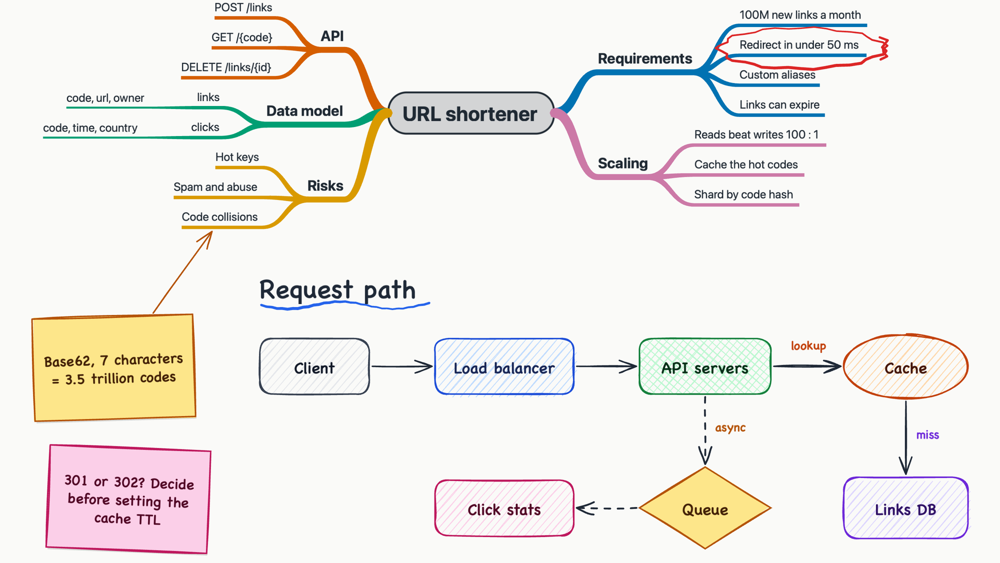
  <br><i>Design review: the map holds the reasoning, the sketch holds the architecture.</i>
</p>

<p align="center">
  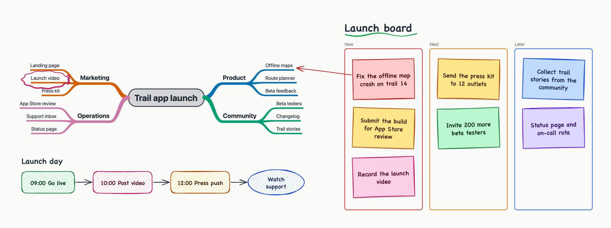
  <br><i>Planning: a Now / Next / Later board in frames, tied to the plan with an arrow.</i>
</p>

<p align="center">
  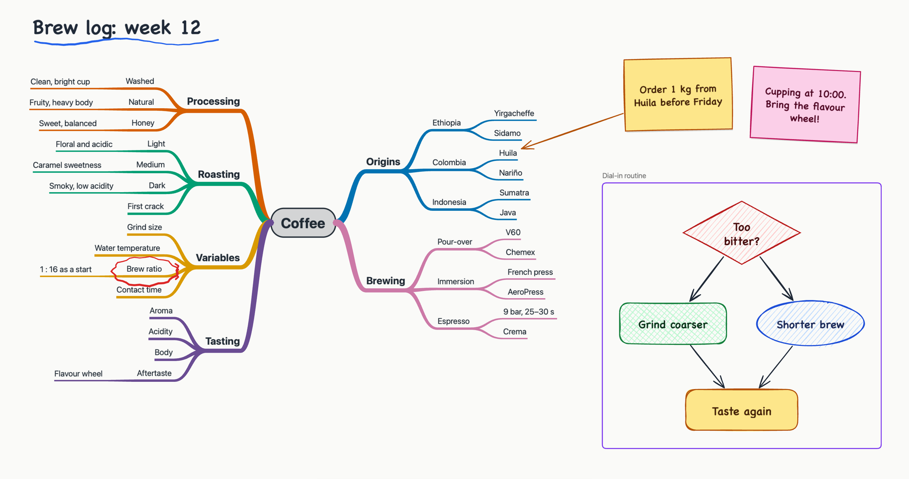
  <br><i>Study notes: reminders, ink and a decision sketch around the map.</i>
</p>

These three maps are in [`samples/`](samples) and open in the app.

## What you can do with it

**Think**
- Type, press Tab, keep going. Maps lay themselves out as you write, with undo for everything.
- Choose a layout per map: balanced, right, left, down, up, compact, radial, outline, timeline, columns or grid.
- Work in the outline beside the canvas when a branch gets long, and find any node by text, note or tag.
- Add notes (with Markdown and LaTeX maths), links, tags, tasks, pictures and stickers to any node.

**Style**
- Restyle a single branch or the whole map from the inspector.
- Customise a theme and keep it for other maps.

**Present and study**
- Turn a map into a step-by-step talk, with a separate presenter console for your notes.
- Hide branches and rebuild them from memory, and schedule spaced reviews.
- Sync tasks with Apple Reminders, and jot ideas into a map from the menu bar with Quick Capture.

**Move work in and out**
- Import Markdown, OPML, FreeMind, Xmind, MindNode and JSON Canvas.
- Export Markdown, OPML, FreeMind, SVG and PDF.
- Preview `.radiant` files in Finder with Quick Look.

<p align="center">
  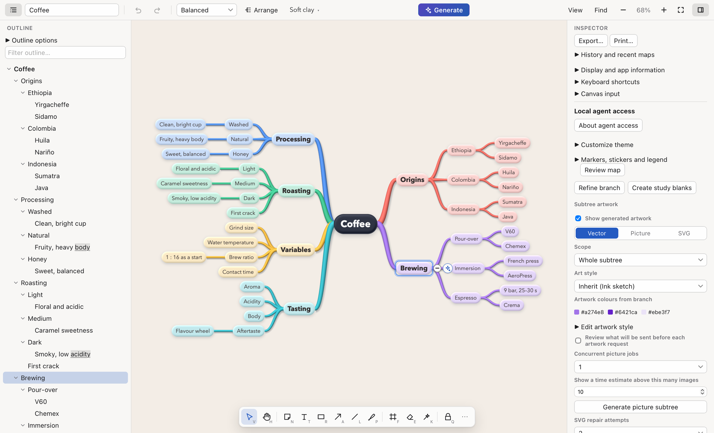
</p>

## Draft with AI, when you want it

<table>
  <tr>
    <td width="50%" valign="top">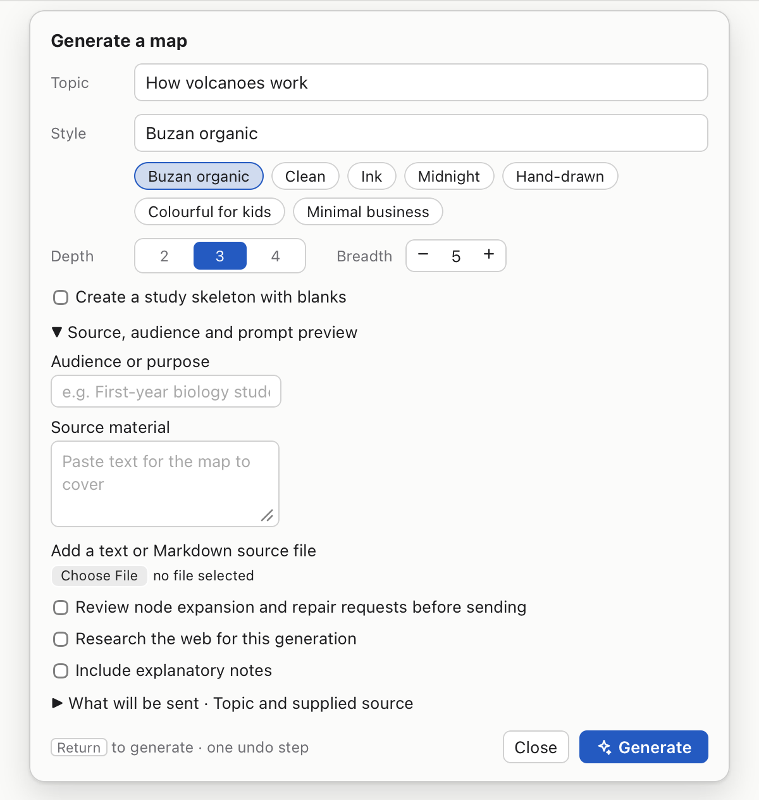<br><p align="center"><b>Generate a map</b> from a topic, your own source text or a file. You choose the style, depth and breadth, and can preview exactly what will be sent.</p></td>
    <td width="50%" valign="top">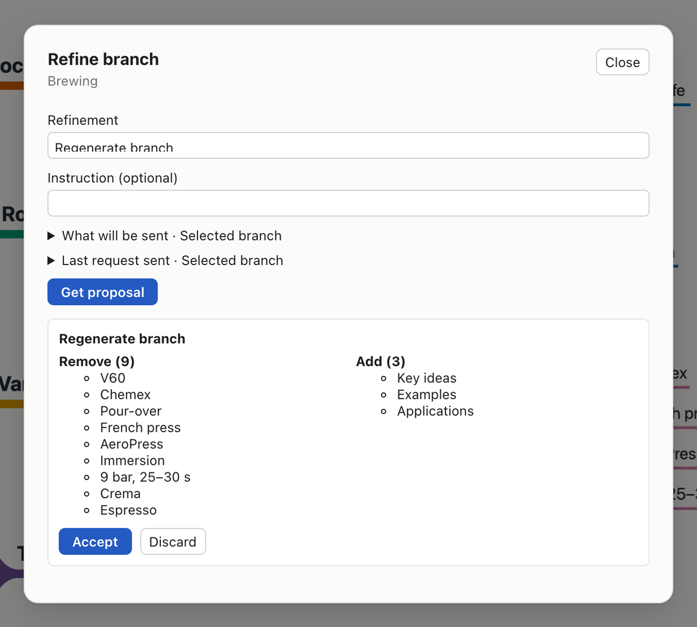<br><p align="center"><b>Refine a branch</b>: regenerate it, rephrase to keywords, summarise, explain into a note, find gaps and cross-links, or write recall questions. Every change arrives as a proposal you accept or discard.</p></td>
  </tr>
</table>

- Generated maps stream onto the canvas node by node, arrive as a draft you can review, and undo in a single step.
- A subtree can be illustrated with generated vector artwork or pictures.
- AI runs through a command-line agent with your own login: the [Codex CLI](https://github.com/openai/codex), [Claude Code](https://github.com/anthropics/claude-code) or the Antigravity CLI. You pick the engine, its model and effort, and the guidance used to expand a branch under **Inspector → AI engine**. Pictures are always drawn with Codex.
- Radiant never reads your credentials, and nothing is sent anywhere unless you start a generation.

<sub>These two screenshots are from the browser preview, which shows built-in sample results instead of calling a model.</sub>

## Built for very large maps

The renderer and layout engine were tuned with a measured, experiment-by-experiment research loop. These are medians from the desktop app on a 50,000-node map (Apple M4 Pro, 60 Hz display):

| Operation on 50,000 nodes | Time |
|---|---|
| Add a node and see it on screen | 0.30 s |
| Fold and unfold a 300-node branch | 0.60 s |
| Switch the whole map to another theme | 0.41 to 0.70 s |
| Load the map | 0.75 s |
| Script time per frame while panning the whole map | under 1 ms |

How it gets there:

- **Branches are expanded on the GPU.** One small record per branch is uploaded; the ribbon, rope twist or clay tube is built in the vertex shader.
- **Edits are incremental.** Sizes, layout, branch geometry and the scene are recomputed only for the part of the map that changed.
- **Heavy work stays off the main thread.** On maps of 1,000 nodes or more, layout and geometry run in a worker that keeps its own copy of the document and receives edits as small operations.

<p align="center">
  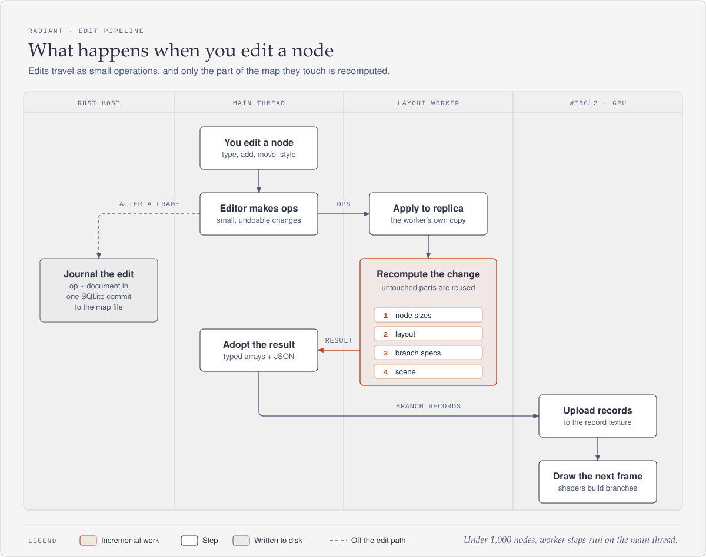
</p>

<p align="center">
  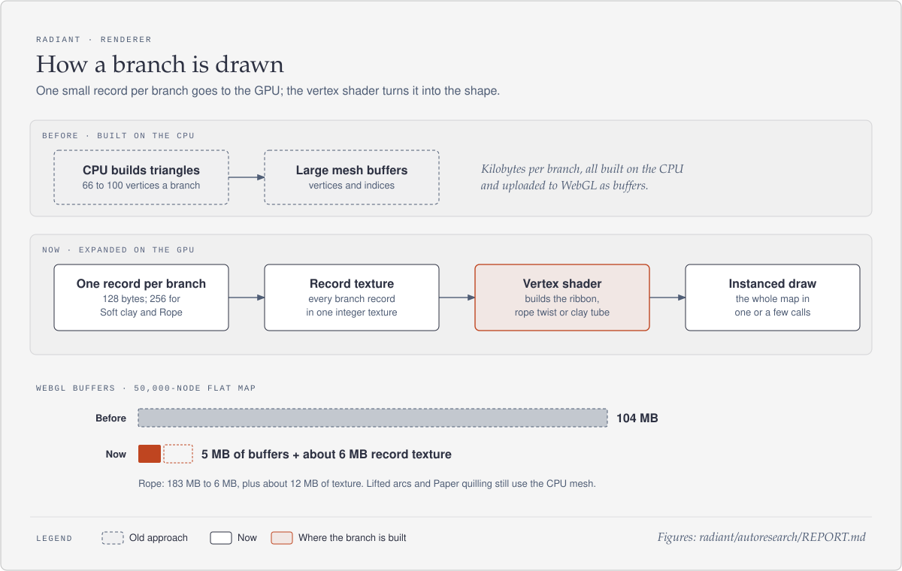
</p>

The full write-up, with every experiment that was kept or discarded and its measurements, is in the [rendering research report](radiant/autoresearch/REPORT.md).

## Your maps stay yours

- **One file per map.** A `.radiant` file is a SQLite database with everything inside it, pictures included. The [file format](radiant/docs/file-format.md) is documented.
- **Hard to lose work.** Saves are atomic, every edit is journalled, and unsaved maps are recovered after a crash.
- **No account, no server.** The app works fully offline.

## Works from the terminal and with assistants

A command-line tool reads, checks, builds and edits maps, and doubles as a local MCP server so an assistant can work on the map you have open, with your permission.

```sh
cd radiant/radiant                                   # the app folder inside the clone
bun tools/agent-cli.ts list ~/Documents/maps        # list maps in a folder
bun tools/agent-cli.ts get plan.radiant             # print a map as an outline with ids
bun tools/agent-cli.ts find plan.radiant "budget"   # search labels, notes and tags
bun tools/agent-cli.ts build notes.map.md           # build a map from a Markdown spec
```

Access from an assistant is granted per map from inside the app and can be revoked at any time. See the [agent skill](radiant/skills/radiant-map/SKILL.md) for the full workflow.

## Getting started

Radiant is built from source for now; there is no signed download yet.

**You need:** macOS on Apple silicon, [Rust](https://rustup.rs), [Bun](https://bun.sh) and the Xcode Command Line Tools.

```sh
git clone https://github.com/parth-patil/radiant.git
cd radiant/radiant
bun install
bun run tauri dev          # run the desktop app
```

Other useful commands, all from `radiant/radiant`:

| Command | What it does |
|---|---|
| `bun run dev` | Run the editor in a browser at `localhost:1420`, with a stand-in for the desktop host |
| `APPLE_SIGNING_IDENTITY=- bun run tauri build --bundles app` | Build an optimised, locally signed `Radiant.app` (about 14 MB) |
| `bun run check` | Type-check the frontend |
| `bun run test` | Run the offline browser checks (needs [uv](https://docs.astral.sh/uv/) and Chrome) |

The AI features need Codex, Claude Code or the Antigravity CLI installed and signed in, and pictures need Codex. Everything else works without them.

## How it is put together

<p align="center">
  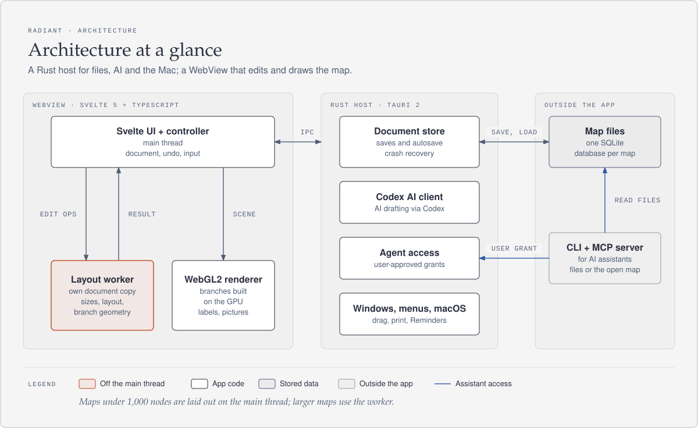
</p>

| Path | What lives there |
|---|---|
| `radiant/src/lib/core` | Document model, layout and geometry in plain TypeScript, with no DOM or WebGL |
| `radiant/src/lib/render` | The WebGL2 renderer, shaders, camera and text |
| `radiant/src/lib/ui` | Svelte components, the controller and the layout worker |
| `radiant/src-tauri` | The Rust host: files and crash recovery, the AI engine clients, windows, menus and macOS integration |
| `radiant/tools` | The command-line tool, the MCP server and the project's checks |
| `radiant/autoresearch` | The benchmark harness and the rendering research report |
| `research_notes`, `report`, `design`, `spikes` | The research, design studies and prototypes behind the app |

More detail is in [ARCHITECTURE.md](radiant/ARCHITECTURE.md).

## Status

Radiant is at version 0.1.0 and under active development.

- It is built and tested on macOS with Apple silicon only.
- Local builds are signed ad hoc. There is no notarised release or auto-update channel yet.
- The performance figures above come from synthetic maps and a 60 Hz display; 120 Hz and Retina output have not been measured.

## Licence

[MIT](LICENSE)
